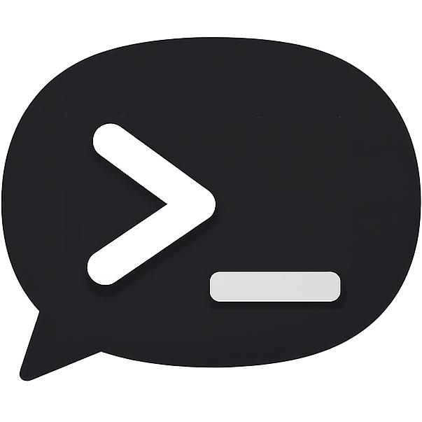
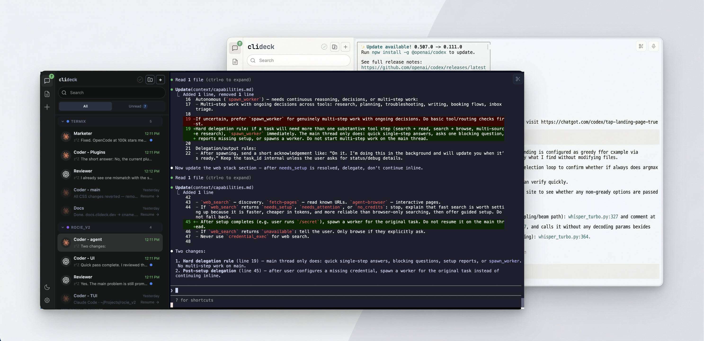
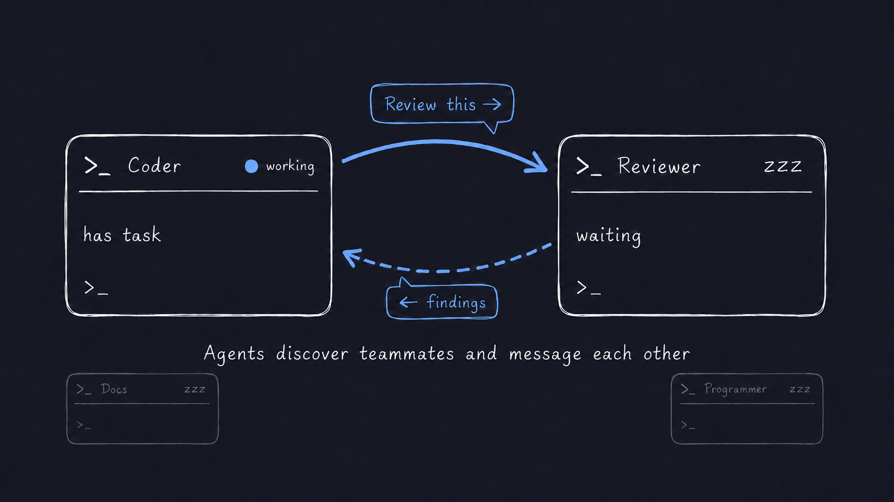

<p align="center">
  
</p>

<h1 align="center">clideck</h1>

<p align="center">
  one screen for AI coding agents.
  <br><br>
  <a href="https://github.com/karinssk/cli-desk-latest">Repository</a> · <a href="https://github.com/karinssk/cli-desk-latest/issues">Issues</a> · <a href="CONTRIBUTING.md">Contributing</a>
</p>

> Maintained by `karinssk` at [cli-desk-latest](https://github.com/karinssk/cli-desk-latest). It includes the local Claude launcher
> and systemd service templates in `bin/` and `systemd/`; private session data is excluded.

<!-- TODO: Replace with a ~10 second GIF showing: open clideck,
     sidebar with multiple agents across projects, click between them,
     one working one idle. No narration needed. -->

<p align="center">
  
</p>

clideck is a local app for running multiple AI coding agents without juggling terminals. Claude Code, Codex, Gemini CLI, OpenCode, and Pi all live in one browser window with a chat-style sidebar, live status, message previews, session resume, and projects to keep things organized. an autopilot routes work between agents automatically, and an E2E encrypted mobile relay gives full control over all agents from a phone.

the main problem with using multiple agents is not starting them. it is managing them. terminals pile up, finished work gets missed, good sessions disappear after a restart. clideck does not sit in the middle rewriting prompts or output - it only watches lightweight status signals from each agent so it can tell which agent is working, which is idle, and which is waiting. everything runs locally, no data leaves your machine.

## Why this exists

Terminal multiplexers are great at panes. clideck is about conversations.

A pane grid is flat. agent work usually is not. projects, previews, timestamps, notifications, resume, and sometimes a bit of routing between specialists all fit more naturally into a chat app layout. it also maps naturally to mobile, so the same mental model works on desktop and phone.

## Quick start

```bash
git clone https://github.com/karinssk/cli-desk-latest.git
cd cli-desk-latest
npm ci
npm start
```

Open [localhost:4000](http://localhost:4000). Click **+**, pick an agent, start working.

Node 18+. Works on macOS, Linux, and Windows 10 1809+. Use `node bin/clideck.js` for CLI commands, or run `npm link` to make `clideck` available locally.

Linux ships prebuilt binaries for glibc x64 and arm64, so nothing compiles. Other Linux setups need to build node-pty from source:

```bash
# Debian/Ubuntu on an architecture with no prebuilt binary
sudo apt-get install -y build-essential python3 && npm ci

# Alpine/musl - a glibc prebuild does exist, so the source build has to be forced
apk add python3 make g++ && npm_config_build_from_source=true npm ci
```

Hit a problem? [Open an issue](https://github.com/karinssk/cli-desk-latest/issues).

If port `4000` is already in use:

```bash
clideck --port 4001
```

## What makes it useful

**Live status** - see which agent is working and which is waiting. Status detection for Claude Code, Codex, Gemini CLI, OpenCode, and Pi.

**Agent & team sidebar** - use the details button at the top-right of a terminal to show its role, task, teammates, model/context usage, session ID, project, folder, Git branch, and master recovery status. Expand **Edit team & task** to assign a team name, role, parent session, and task. Assignments are saved across restarts; teammate buttons open exact session IDs, even when names repeat. Team membership is explicit, and unavailable provider data is shown as “Not reported.” The sidebar collapses on desktop and overlays narrow screens.

Run `npm run test:sidebar` for desktop and mobile browser checks with an installed Chrome, or set `CHROME_BIN` to another installed Chromium executable.

**Dashboard** — open `/dashboard.html` or the dashboard icon in the terminal navigation rail. Overview, Agent teams, and Recovery views refresh live local session/helper data every five seconds. Search sessions and open exact parent terminals; monitoring is read-only. Disconnected data is labeled stale and activity becomes Unknown. Run `npm run test:dashboard` for desktop/mobile browser checks.

**Chat agents** also includes persistent native Codex spawn history, not just Codex Teams registrations. On Node runtimes with `node:sqlite`, CliDeck reads the local `state_5.sqlite` spawn-edge index read-only, including nested helpers. It reads each helper's recent local turn events to show Finished or recently active Working, with last activity visible and finished helpers separated into History. Stale or unobserved activity stays Unknown. Recorded model metadata is not model attestation. Duplicate native IDs are merged, and unrelated chats and private prompt fields are excluded. Without SQLite support or a supported metadata schema the sidebar reports history unavailable.

Assigned team, role, parent ID, and task are included in Codex/Claude startup instructions on launch or resume. Changes to a running agent are queued for its next submitted message while not busy; the sidebar's **Agent instructions** field reports pending/submitted delivery. Other supported AI CLIs use this next-message path; shell terminals never receive injected text. Automatic recovery/approval inputs do not deliver assignments. Model defaults are recommendations, not model switches. Agents can refresh authoritative assignments with `clideck agents --json --all`. Persistence across restarts requires a resumable session with a captured session token.

**Session resume** - close the lid, reopen tomorrow, pick up where things left off. each agent's session ID is captured automatically.

**Ask another session** - from inside any CliDeck session, an agent can consult another session and get the answer back as command output:

<p align="center">
  
</p>

```bash
clideck agents
clideck ask --session "Reviewer" --message "Review this output and return findings." --timeout 10m
```

CliDeck injects the message into the real target terminal, submits it, waits for the target session to finish, then returns the latest response to the caller.

By default, target lookup is limited to the caller's project. For cross-project asks, discover the full address first:

```bash
clideck agents --all
clideck ask "@website/Docs Writer" "Check if the docs mention the new CLI flags." --timeout 15m
```

If project or session names contain spaces, quote the whole target. The target is another LLM agent, not a fast CLI command, so callers should set both `clideck ask --timeout` and their own shell/tool timeout high enough. If the target session is busy, CliDeck does not queue the message; the caller gets a clear busy response and can retry later or ask another idle session.

**Mobile remote** - the agents keep running on the local machine. status, prompts, history, and replies stay available from a phone while away. E2E encrypted, no account needed.

**Master terminal monitor** - watch sessions active today across projects from a separate terminal:

```bash
clideck master --today
# Permit recovery of today's agents after a settled Bad Request error:
clideck master --today --recover --all
# Or select one exact session ID printed by the monitor:
clideck master --today --recover --session <id>
```

The monitor prints live session events and recovery decisions. Today uses Asia/Bangkok by default; change it with `--timezone`. Recovery sends `continue` after a settled terminal `■ {"detail":"Bad Request"}` error; Codex screen rendering verifies an empty prompt even when its busy status is stale. It skips approval menus and changed input, allows three attempts without a new displayed tool step, keeps a 30-second cooldown, and leaves closed sessions closed. A new tool block resets the retry budget. Quiet working sessions are reported for inspection. Ctrl+C stops the monitor without stopping agents.

Tell managed agents to print `[CLIDECK:DONE]` alone on a line after completing and checking their task, or `[CLIDECK:BLOCKED]` / `[CLIDECK:FAILED]` when they cannot proceed. An idle session without a marker remains idle; it is not reported as completed. Restart the CliDeck server to load the master API before first use; a restart also interrupts live sessions, so finish or save their work first.

**Native terminals** - each session opens into its real terminal. keys go straight to the agent, nothing sits in the middle.

## Supported agents

Claude Code, Codex, Gemini CLI, OpenCode, Pi, Shell, and any other terminal tool.

## Also

- **Projects** - group sessions, drag and drop
- **Prompt library** - save reusable prompts, type `//` to paste
- **Search** - find sessions or scroll through transcripts
- **Plugins** - server + client API. ships with Voice Input, Trim Clip, and Autopilot. build your own
- **15 themes** - dark, light, or make your own
- **Notifications** - browser + sound alerts when agents finish

## Docs

Run `npm test` for local regression checks. See [CONTRIBUTING.md](CONTRIBUTING.md) for changes and verification.

## Acknowledgments

Built with [xterm.js](https://xtermjs.org/).

## License

MIT - see [LICENSE](LICENSE).
